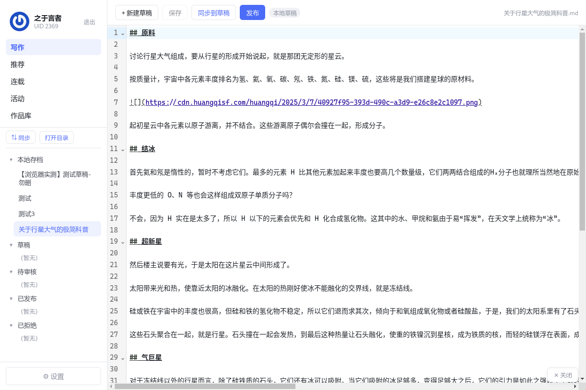
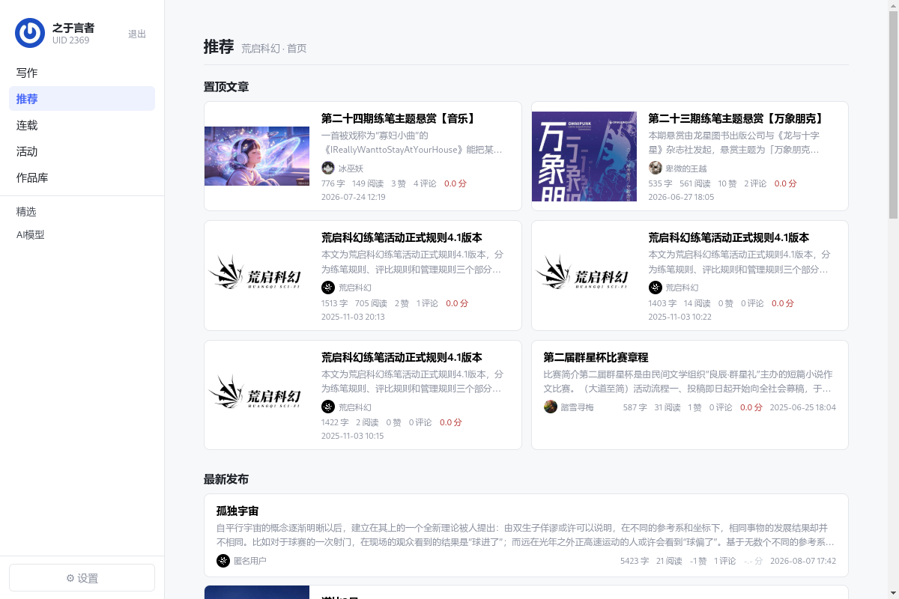

# 黄芪饮片桌面客户端（hq-scifi）

[](https://github.com/Kide-Lee/HQ-SciFi/releases)
[](LICENSE)
[](https://github.com/Kide-Lee/HQ-SciFi/releases)

> ⚠️ **第三方非官方客户端**：本项目为独立开发的桌面客户端，与「荒启科幻」官方无隶属关系。

[荒启科幻](https://www.huangqisf.com/h5/#/)（huangqisf.com）写作社区的桌面客户端，为**写作、阅读、评审**提供一站式体验。

本项目由由 [Reasonix](https://github.com/esengine/DeepSeek-Reasonix) AI 编码代理驱动的 [DeepSeek](https://github.com/deepseek-ai/) 模型全程参与开发。

## 功能特性

- **写作**：本地编辑双模式——**可视化**（milkdown 所见即所得，工具栏支持粗体/楷体/标题/列表/引用/公式/音乐/视频/图片）与**源码**（CodeMirror 6），自动保存 + Ctrl+S；草稿 / 待审核 / 已发布 / 已拒绝四态管理，一键与荒启草稿箱同步、发布（发布表单：类型 / 标签 / 活动 / 公开阅读，字数 3000–33000 限制）；**远端文章可直接「编辑」「转存为草稿」拉到本地编辑**；写作首页本地存档以文章卡片展示（文件夹组织 + 面包屑导航 + 按编辑时间 / 字数排序），删除移入系统回收站（可恢复），正文配图随同步下载到本地 `.image` 目录并在推送时自动上传
- **阅读**：推荐（精选 / AI 模型 / 首页置顶与内容流）、连载（推荐合集 / 推荐连载）、练笔活动（近期活动 / 活动树展开文章）、作品库五大栏目；正文安全净化渲染；列表排序支持评分 / 点赞 / 评论 / 阅读 / 字数 / 时间 / 回复，全部可倒序（↑/↓），并列排名同名次；**未登录也可浏览与匿名阅读公开文章**（仅当服务端确认文章不可读时才提示登录，网络故障不误标）
- **用户系统**：点击头像进入用户页——展示昵称 / 等级 / UID / 粉丝 / 文章 / 评论（本人页含关注）与主页背景；主页四栏（收藏 / 文章 / 评审 / 评论）与子页（动态 / 收藏 / 粉丝 / 文章 / 评审 / 评论）；关注动态聚合、签到领能量币、统计直达子页；**启动始终进入推荐首页，左栏用户卡可进入本人用户页**；投稿期 / 评稿期活动文章与评审全站匿名且不暴露评分
- **搜索 / 替换**：任意界面 **Ctrl+F** 调出右栏搜索（Word 导航窗格版式）——文章页正文高亮跳转、编辑器支持批量 / 逐个 / 正则替换、写作首页与栏目列表搜标题 / 摘要直达
- **评审**：接入官方五维评审体系（设定 / 文笔 / 人物 / 情节 / 思想性）；「我的评审 / 所有评审」双视图，可随时编辑自己的评审；所有评审按时间 / 评分 / 开心 / 有用 / 认真排序 + 倒序；评审栏与正文可拖动分栏（默认 1:2）、字号与正文一致、编辑框随内容自动增高、实时平均分预示、评者头像
- **活动**：活动按钮红点提示未完成评审任务；进行中 / 评审中活动带状态标记，且其文章不进入评分榜、不显示评分与排名
- **界面与交互**：无边框自绘顶栏（页面标题居中 / 窗口控件 / 返回列表，顶栏与左栏空白处可拖动窗口）；左栏可折叠、宽度可调（目录 / 文件树展开收起带动画）；阅读页右栏「目录 / 评论 / 评审」一体 tab，评论与评审双向联动（同一评审的评论聚合、跳转对应评审、回复评审），评审评论内嵌于评审卡片、态度反应 emoji 化；互动按钮悬浮文章右下角（投币 / 点赞 / 收藏 / 分享 + 置顶）；文章卡片高度统一、封面加载失败占位兜底、摘要区居中 / 无摘要提示
- **安全**：登录凭据经系统钥匙串加密（Windows 凭据管理器 / macOS Keychain / Linux Secret Service）仅存 Tauri 主进程、渲染层隔离、远端内容白名单净化防 XSS；**首次启动须阅读并同意《黄芪饮片用户协议》**（滚动到底才能勾选）；**登录仅需本应用协议，不再要求荒启平台用户协议**；**每次启动自动校验会话有效性**，token 失效自动丢弃并退回未登录（网络异常不误登出）；任意界面 Ctrl+F12 打开开发者工具

## 界面






## 安装

从 [GitHub Releases](https://github.com/Kide-Lee/HQ-SciFi/releases)（最新版本以 Releases 页为准）下载安装包：

| 平台 | 包 |
| --- | --- |
| Windows 10/11（x64） | NSIS 安装包 `.exe`（依赖系统 WebView2，Win11 自带） |
| Linux（x64） | `.deb`（Debian 12+/Ubuntu 22.04+，需 `libwebkit2gtk-4.1`）或 `.AppImage`（需 `libwebkit2gtk-4.1` + `libfuse2`） |
| macOS（11+） | `.dmg`（Apple Silicon / Intel 各一个，未签名时右键「打开」） |

文件名形如 `hq-scifi_<版本>_<平台>.<扩展名>`，实际下载以 [Releases](https://github.com/Kide-Lee/HQ-SciFi/releases) 页为准。**2.0 起渲染引擎改用系统 WebView（WebKitGTK / WebView2 / WKWebView），安装包体积从 ~90 MB 降到 7–14 MB；Linux 不再自带渲染引擎，需系统装有 `libwebkit2gtk-4.1`。**

### 从源码构建

环境要求：Rust stable ≥ 1.90 + Node.js ≥ 22。Linux 还需 `libwebkit2gtk-4.1-dev libgtk-3-dev libayatana-appindicator3-dev librsvg2-dev patchelf`；macOS 需 Xcode Command Line Tools；Windows 需 MSVC 工具链。另外需要一份荒启接口配置 `api.config.json`（模板见 `api.config.example.json`，不入库）。

```bash
npm ci
npm run build:web                                    # 渲染层 → out/web
node src-tauri/scripts/gen-tauri-commands.mjs --write   # 生成 85 条命令 dispatch（gitignored）
node src-tauri/scripts/prepare-resources.mjs            # 打包资源（协议/更新日志/api.config.json）
cargo install tauri-cli --version "^2" --locked
cd src-tauri && cargo tauri build                       # 产物在 src-tauri/target/release/bundle/
```

开发时用 `cargo tauri dev`。提交前建议跑一遍不编译壳的自检（详见 `AGENTS.md` 的「编译前自检」）：`cargo test -q -p hqsf-core --lib`、`cargo clippy --all-targets -- -D warnings`、`cargo run -q -p hqsf-bindings -- --check`、`node src-tauri/scripts/gen-tauri-commands.mjs --verify`、`npm run typecheck`。

> **本地测试模式**（对接自建 RuleApi / 本地接口联调）：给可执行文件加 `--test`（或环境变量 `HQSF_TEST=1`）。测试模式与正式使用完全隔离——独立数据目录（`~/.local/share/hqsf-test`，数据库/session/设置不混入正式库）、API 配置优先读本地持有的 `api.config.test.json`（baseUrl 指向本地服务，不入库）、默认存档根为 `~/文档/荒启科幻/草稿-test`。两者可同时运行。
>
> 出包由 CI 的 `.github/workflows/release.yml` 完成（tag `v*` 正式发布 / 分支 `build-only` 只构建验证）。三平台产物、自检结果与体积回写在 `release-status` 分支。

## 使用

1. 启动客户端：**首次启动先阅读并同意《黄芪饮片用户协议》**方可进入；未登录也可直接本地写作、浏览栏目、匿名阅读公开文章；**启动始终进入推荐首页**，已登录用户可从左栏用户卡进入本人用户页
2. 登录（左栏用户卡「点击登录」，账号密码，仅需同意本应用协议）后启用同步 / 发布 / 评论 / 评审；**每次启动自动校验会话**，token 失效自动退回未登录；登录后可在左栏用户卡**签到**领能量币
3. **用户页**：点击左栏头像或任意用户头像进入；主页与子页可查看收藏 / 文章 / 评审 / 评论、关注 / 粉丝与动态；点击头部统计可直达对应子页
4. **写作**：左侧「写作」→ 新建草稿 → 编辑（自动保存）→ 「同步到草稿」或「发布」（发布表单填写类型 / 标签后提交，发布后进入官方审核流程，审核通过即公开）
5. **阅读**：通过左侧栏目（推荐 / 连载 / 活动 / 作品库）浏览文章，点击卡片进入阅读
6. **评审**：打开他人文章 → 「✎ 评审这篇文章」→ 填写五维评分与评语 → 提交

## 官方渠道

- 官方网站：[荒启科幻](https://www.huangqisf.com/)
- 官方 QQ 群：**280660235**（[点此加群](http://qm.qq.com/cgi-bin/qm/qr?_wv=1027&k=6A1FVREgm38a7LrOMIF_I4A_peDk1RPH&authKey=DE8Pl0%2Fb9BnwXfPbTcV8N920c3BW4hlRZ84tnA47lG)）

## 文档

- [产品简介](doc/design/简介.md) · [产品定位与范围](doc/design/产品定位与范围.md)
- [荒启 API 调查报告](doc/api-research.md)
- [荒启网站现状调研](doc/site-overview.md)
- Tauri：[迁移计划](doc/design/Tauri迁移计划.md) · [Tauri 命令契约](doc/design/Tauri命令契约.md) · [Rust 实现约定](doc/design/Rust实现约定.md) · [迁移验收](doc/design/Tauri迁移验收.md) · [真机验证清单](doc/design/真机验证清单.md)

## 技术栈

Tauri 2.12 · 后端 100% Rust（`crates/hqsf-core`，rusqlite / reqwest / comrak + QuickJS 内嵌 KaTeX·turndown / keyring）· React 19 · TypeScript · Vite 7 · Milkdown 7（ProseMirror 可视化编辑）· CodeMirror 6 · Zustand · lucide-react（图标）

## 免责声明

- 本项目为第三方独立开发，非官方出品；请勿将本项目用于任何违反荒启科幻服务条款的用途。
- 站内文章等内容版权归原作者与平台所有，本客户端仅作本地管理与浏览工具。
- 请自行保管账号安全，遵守[荒启科幻](https://www.huangqisf.com/)的使用规则。

## License

[MIT](LICENSE) © 2026 之于言者
